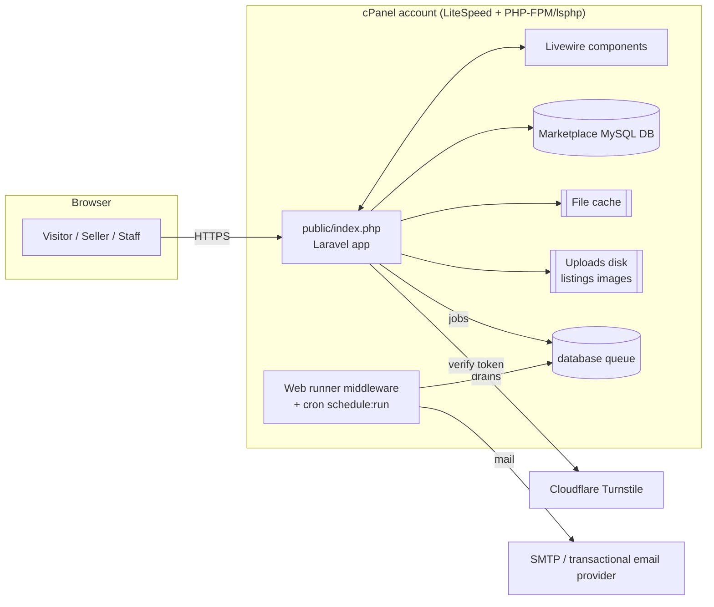
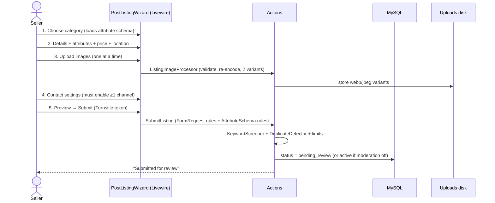
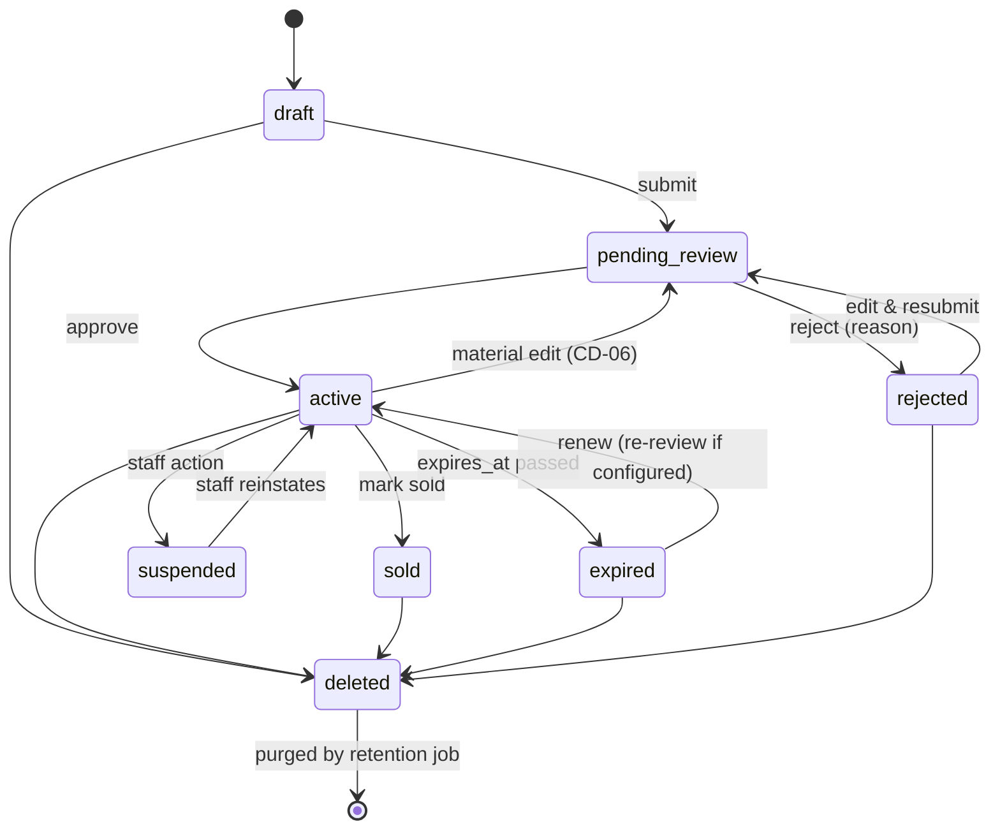

# System Architecture

| Field | Value |
|---|---|
| SDLC phase | 2 — System architecture and technical design |
| Status | **Approved 2026-10-11 (revision 2). Global-marketplace revision pending approval** ([global design](13-global-marketplace.md)): sections affected are §3 (Geo/Money modules), §8 (URLs), §9 (formatting). Verification conditions in §12 remain open until checked. |
| Date | 2026-10-11 |
| Inputs | [Requirements spec v0.2](../requirements/requirements-specification.md), owner decisions (`docs/02-system-design.md`), [Dev Talk inspection](01-existing-devtalk-inspection.md) |

Labels: **[CONFIRMED]** owner decision · **[VERIFIED]** checked evidence · **[RECOMMENDED]** proposal awaiting approval · **[ASSUMPTION]** stands until disproved · **[OPEN]** unresolved.

---

## 1. Architecture Summary

A **server-rendered Laravel monolith** with Blade + Livewire for interactivity, deployed as its own application on a Dev Talk subdomain with its own MySQL database. No SPA, no separate API server, and no long-running processes.



**Why a monolith:** one developer, shared hosting, an SEO-critical public site, and a small MVP. Livewire gives a reactive UI (filters, image uploads, posting wizard) without a JavaScript build on the server or SSR infrastructure. Modules are kept separate by folder and namespace, so features such as messaging or payments can be added later without a rewrite.

## 2. Technology Stack

| Layer | Choice | Label | Notes |
|---|---|---|---|
| Language | **PHP 8.4 preferred, 8.3 minimum** | [APPROVED CD-01] / host [UNVERIFIED] | PHP 8.4 security support runs to Dec 2028, covering Laravel 13. PHP 8.3 ends Dec 2027. Host evidence: `ea-php83`. See [package assessment](10-package-assessment.md). |
| Framework | **Laravel 13** | [APPROVED CD-01] | Requires PHP ≥ 8.3. Security fixes until 17 Mar 2028 [VERIFIED laravel.com]. |
| UI | Blade + **Livewire 4** + Alpine (bundled) | [CONFIRMED] Q13 | SEO: Livewire renders full HTML on first load. |
| CSS | **Tailwind CSS 4** + Vite, design tokens as CSS variables, class-based dark mode | [RECOMMENDED] | Own marketplace theme (Phase 3). Assets prebuilt, no Node on server. |
| Auth backend | **Laravel Fortify** (headless) with own Livewire/Blade views | [RECOMMENDED] | Registration, email verification, reset, password confirm, TOTP 2FA for staff. |
| Roles/permissions | **spatie/laravel-permission** | [RECOMMENDED] | Owner/Admin/Moderator plus granular permissions. See [authorization](05-authorization.md). |
| Translatable DB labels | **spatie/laravel-translatable** (JSON columns) | [RECOMMENDED] | Category, attribute and option labels ready for Sinhala/Tamil (Q5). |
| Images | **intervention/image v4**, GD driver default, Imagick if present | [APPROVED CD-05] | Driver chosen by config. See [security](06-security-and-uploads.md) §4. |
| SEO | Own `PageSeo` service (meta, OG, JSON-LD) + own `SitemapBuilder` | [RECOMMENDED] | spatie/laravel-sitemap dropped (v8 needs PHP 8.4; pulls a crawler and Guzzle). All URLs from `APP_URL`. |
| Search | MySQL **FULLTEXT** behind a `ListingSearch` interface | [RECOMMENDED] | Meilisearch implementation can be swapped in later. |
| Bot protection | **Cloudflare Turnstile** + honeypot + rate limits | [RECOMMENDED] Q8 | Turnstile does **not** require the domain to use Cloudflare DNS. See security doc §6. |
| Database | MySQL 8.0+ / MariaDB 10.6+ (InnoDB, utf8mb4) | [RECOMMENDED] minimum | Production version [OPEN] (hosting doc §2). |
| Cache / session / queue | `file` cache, `database` sessions, `database` queue | [RECOMMENDED] | No Redis assumed. Env-driven, so Redis can be added later. |
| Mail | Env-based mailer: host SMTP for development; dedicated provider for production | [CONFIRMED] Q14 / provider [OPEN] | ADR-009. |
| Testing | PHPUnit (or Pest) feature + unit tests, SQLite in-memory plus a MySQL CI job for FULLTEXT | [RECOMMENDED] | |
| Quality | Laravel Pint, Larastan (level 5+), `composer audit`, `npm audit` | [RECOMMENDED] | |

**Package policy:** every Composer package is a manual `vendor` upload on this host (no Composer on server), and every package needs approval. The approved package set and its compatibility evidence are in [package assessment](10-package-assessment.md).

## 3. Module Structure

Laravel conventions with feature folders. There is no heavyweight DDD.

```
app/
  Actions/                  single-purpose domain operations (invokable)
    Listings/               CreateDraftListing, SubmitListing, ApproveListing, RejectListing,
                            RenewListing, MarkListingSold, ExpireListings, DeleteListing
    Users/                  SuspendUser, BanUser, DeleteAccount, AnonymiseUser
    Reports/                FileReport, ResolveReport
  Enums/                    ListingStatus, ListingType, PriceType, Condition, ContactVisibility,
                            AttributeType, ReportReason, ReportStatus, UserStatus
  Http/
    Controllers/            thin controllers for non-Livewire pages and JSON endpoints
    Middleware/             EnsureAccountActive, RunBackgroundTasks, SecurityHeaders, SetLocale
    Requests/               Form Requests (server validation)
  Livewire/
    Public/                 SearchPage, ListingGallery, ContactReveal, ReportForm, FavouriteToggle
    Account/                PostListingWizard, MyListings, Favourites, ProfileSettings, ContactSettings
    Admin/                  Dashboard, ModerationQueue, Reports, Users, Categories, Attributes,
                            Locations, Pages, Settings, Staff, AuditLog, Blocklist
  Models/
  Policies/                 ListingPolicy, ReportPolicy, UserPolicy, CategoryPolicy, ...
  Services/
    Attributes/             AttributeSchema (rules + form schema per category), AttributeValueWriter
    Images/                 ListingImageProcessor, ImageVariantSet
    Search/                 ListingSearch (interface), MysqlListingSearch
    Moderation/             KeywordScreener, DuplicateDetector
    Seo/                    PageSeo, StructuredData, SitemapBuilder
    Contact/                ContactResolver (who can see which channel)
    Geo/                    CountryContext (current country), LocationResolver, GeoNamesImporter (CLI only)
    Money/                  Money::format (ICU), UnitPrice, AreaConverter (bcmath)
    Security/               Turnstile
  Support/                  Settings (typed site settings with config defaults), MailBudget
  Notifications/            ListingApproved, ListingRejected, ListingExpiringSoon, AccountSuspended, ...
config/marketplace.php      limits, expiry, moderation mode, retention, image sizes, feature flags
lang/en/                    every user-facing string (Q5)
```

**Reserved for future modules** (no code in the MVP): `Messaging/`, `Billing/` (featured listings, subscriptions), `Sso/`. The contact layer resolves channels through `ContactResolver`, so internal messaging can plug in later as another channel (Q10).

## 4. Key Request Flows

### 4.1 Post a Listing



A draft is saved after step 2, so leaving and returning keeps progress.

### 4.2 Listing Lifecycle



**Moderation of updates (CD-06, ADR-017):**

- **Material edits** (title, description, category, images, attributes, location, listing type) on an `active` listing set it back to `pending_review`. The listing leaves public view until re-approved.
- **Non-material edits** apply immediately: contact toggles, mark sold, renew. These still get the same ownership and permission checks.
- **Price edits** [APPROVED, Q-MOD-1]: apply immediately but are recorded in a "recent changes" moderation feed.
- *Alternative considered:* keep the approved version public while a pending revision awaits review. Rejected for the MVP (needs a revisions table and image versioning). It can be added later.

`deleted` is a soft delete (`deleted_at`), not a status value. Public visibility is **one query scope**: `status = active AND expires_at > now() AND deleted_at IS NULL AND owner not suspended`. Expiry is therefore enforced at query time, even if the scheduled `ExpireListings` job runs late.

> **Implementation status (T4.4a, submit + moderation):** `App\Actions\Listings\SubmitListing` (draft or rejected → `pending_review`, or straight to `active` per `MARKETPLACE_MODERATION_MODE`: `all` at launch (CD-06), `new_users` until one ad of the seller has been published, `none`; a flagged ad always goes to review). It checks, in order: Turnstile when configured (fails open, the ad is moderated anyway); every step finished (location chain still valid, category available, details, required and condition-required attributes, price option and amount, rent period); at least one photo (LST-02); a contact channel visible to someone (`ContactChannels`, MSG-03); at most `max_active_per_user` live or pending ads, under a lock on the seller row (LST-09); `ListingScreener` (MOD-03, LST-10): `blocked_terms` with `block` refuses the ad, `flag` terms, phone numbers or emails in the text and a same-title ad by the same seller in the same category within 7 days set `flagged`. `ModerateListing` approve / reject (reason required) / request changes (stored as `rejected` with the note; the seller edits and resubmits): permission `listings.moderate`, never on one's own ad, row lock + status re-check (two moderators cannot both decide), `audit_logs` row (MOD-04, IP as HMAC, rows append-only in the model), queued `ListingApproved` / `ListingRejected` mail after commit (MOD-05; in-app notifications later). Only the `flagged` bit is stored; the moderation screen (M6) re-runs the screener to show reasons.
> **Implementation status (T4.4b, lifecycle):** the wizard step actions now also edit ads waiting for review and live ads (`EditsDrafts::authorizeEdit`; sold, expired and suspended ads are not editable). A **material edit** (details/attributes, location below the country, adding or removing photos) of a submitted ad re-runs the screener inside the step's transaction (a blocked term rolls the edit back) and, when `ModerationRules` requires review (mode `all`, `new_users` before a first publication, or flagged), takes a live ad back to `pending_review`. Reordering photos, choosing the cover and contact toggles (`UpdateListingContact`, which keeps at least one visible channel on a submitted ad) are not material. **Price edits** apply at once and are written to `audit_logs` as `listing.price_changed` with before/after (the moderators' "recent changes" feed, Q-MOD-1). **Deviation:** once submitted, the country and category cannot change (they would clear the price or details of a published ad); the seller posts a new ad. A submitted ad keeps at least one photo. `ListingLifecycle`: mark sold (live only), renew (live ads in the last `renew_window_days`; expired ads within `retention.expired_listing_renewable` days, without a new review, counting toward the live-ad limit), soft delete. `SuspendListing` (permission `listings.suspend`, not on one's own ad, reason required, audited, seller emailed): reinstating restores a published ad as live and sends a never-approved ad back to review. `marketplace:expire-listings` (hourly) sends one "expires soon" email per period (`listings.expiry_reminder_sent_at`, reset on renewal) and marks expired ads with an "expired" email; visibility never depends on it (public scope).

### 4.3 Contact a Seller (Q6, Q10)

1. The listing page shows contact buttons according to `ContactResolver`. The effective visibility is the **stricter** of the seller's account setting (`hidden` / `registered` / `public`, default **hidden**) and the per-listing toggles (call, WhatsApp).
2. The phone number is **never in the page HTML**. "Show number" calls `POST /listings/{id}/contact` (rate-limited, Turnstile-protected for guests after a threshold). The call returns the number or a `wa.me` link and logs a `contact_reveals` row.
3. If the visibility is `registered` and the visitor is a guest, the button reads "Log in to contact seller".
4. A listing cannot be submitted unless at least one channel is visible to someone. The wizard forces the seller to choose explicitly, which satisfies "hidden by default until the seller chooses".

## 5. Configurable Categories and Attributes (Q11)

There are no per-category tables. A **typed attribute model** is used:

- `attributes`: global definitions (key, translatable label, type, unit, validation).
- `category_attribute`: attaches attributes to categories, with per-category `is_required`, `is_filterable`, `show_on_card` and `sort_order`. Subcategories inherit the parent's attributes.
- `attribute_options`: values for select types, with an optional `parent_option_id` for dependent selects (Make → Model).
- `listing_attribute_values`: one row per value with **typed columns** (`value_number`, `value_option_id`, `value_text`, `value_bool`), each indexed with `attribute_id` for filtering.
- `listings.attributes_summary` (JSON): denormalised display copy for cards and detail pages. Avoids joins when rendering lists.

`AttributeSchema` builds both the **Livewire form** and the **server validation rules** from the same definition, so they can't drift apart. Full schema in the [database design](03-database-design.md), and the proposed tree in the [category tree](04-category-tree.md).

## 6. Background Work Without an Every-Minute Cron

The register.lk host appears to block 1-minute cron jobs [INFERRED]. Design rules:

1. **Nothing user-critical waits on the queue.** Image processing runs synchronously during upload. Listing state changes are immediate. Expiry is enforced at query time (§4.2).
2. **Queued:** emails/notifications, sitemap regeneration, retention pruning, view-count flushes.
3. **Runners:**
   - a cron entry `php artisan schedule:run` at the **shortest interval the host allows** (e.g. every 5 or 15 minutes) [OPEN: verify interval];
   - a `RunBackgroundTasks` middleware that, at most once per minute across all visitors (atomic cache lock), drains the queue for at most about 15 seconds **after** the response is sent (LiteSpeed `litespeed_finish_request` / `fastcgi_finish_request`). This pattern is proven on Dev Talk; it is reimplemented here, not shared.
4. All jobs are idempotent and safe to retry. Scheduled tasks use `withoutOverlapping()`.

| Scheduled task | Frequency |
|---|---|
| Drain queue (`queue:work --stop-when-empty --max-time=50`) | every run |
| `listings:expire` (status flip + notify) | hourly |
| `listings:remind-expiring` (3 days before) | daily 09:00 Asia/Colombo |
| `sitemap:generate` (static files) | daily |
| `marketplace:prune` (retention, see [data retention](09-data-retention.md)) | daily 03:00 |
| `model:prune` (contact reveals, old notifications) | daily |

> **Implementation status (T7.1):** the schedule lives in `routes/console.php`. Expiry and the 3-day reminder run together in `marketplace:expire-listings` (hourly), not as a separate 09:00 job. The scheduler drains the queue on every run. `RunBackgroundTasks` (enabled by `WEB_RUNNER_ENABLED`) only drains the queue (it does not run the scheduler, which needs the host cron at its shortest allowed interval). `MailGate` sends everything to the `log` mailer until `MAIL_SENDING_ENABLED=true`. `MailBudget` counts every message per clock hour and holds queued mail when `MAIL_HOURLY_LIMIT` is reached.

## 7. Caching and Performance Plan

[ASSUMPTION — not a target] Year-one planning envelope: up to about **5,000 active listings**, **50,000 monthly visits** and **1,000 registered sellers**. The owner has not confirmed any volume (Q16). These numbers only size the design.

| Technique | Detail |
|---|---|
| Pagination | 24 per page. Simple (cursor-like) pagination on deep pages. Max page depth 100 to stop crawl abuse. |
| Indexes | Composite indexes match the public scope + sort: `(status, category_id, published_at)`, `(status, district_id, published_at)`, `(status, price)`, FULLTEXT `(title, description)`. Details in database doc §4. |
| N+1 prevention | Cards eager-load `coverImage`, `city`, `category`. `Model::preventLazyLoading()` in non-production. |
| Cache (file driver) | Category tree, attribute schemas, settings, location lists, home "latest" block (5 min), counts per category (15 min). Busted on admin change. |
| HTTP caching | Static assets: hashed filenames with a long `Cache-Control`. Images: long cache, immutable paths. |
| Images | WebP (JPEG fallback) in 2 sizes, `loading="lazy"`, `srcset`, explicit width/height (no layout shift). |
| Views | Throttled view counter: one per visitor per listing per day (cache key) and batched `increment`. |
| Production optimisations | `php artisan optimize` (config/route/view/event cache), OPcache [verify enabled], `APP_DEBUG=false`, `LOG_LEVEL=warning`. |

### 7.1 Scaling Path

Summary below. The full staged plan (indexing, caching, images, queue, search, rate limiting, hosting) and triggers are in [domain migration and portability](11-domain-migration-and-portability.md) §6.

| Stage | Trigger (indicative) | Change | Code impact |
|---|---|---|---|
| 1. Shared cPanel | Launch | As designed | — |
| 2. Offload media | Inode or disk limits near (hosting doc §3) | S3-compatible storage (e.g. Cloudflare R2) + CDN | Change the `listings` disk in `.env` and run a one-time copy command |
| 3. VPS | CPU/entry-process limits hit, or real-time needs | Redis (cache/queue/session), Supervisor workers, real cron | `.env` driver changes only |
| 4. Search engine | FULLTEXT relevance or latency insufficient | Meilisearch via `ListingSearch` interface | New implementation class + indexer job |
| 5. Messaging / payments | Business decision | New modules | Additive |

## 8. SEO Design

| Concern | Design |
|---|---|
| Rendering | All public pages are server-rendered HTML. Livewire hydrates filters after the first load. |
| URLs | **Revised (ADR-023):** country-prefixed browse pages `/{cc}/ads/{category?}/{sub?}`, location landing pages `/{cc}/ads[/{category}]/in/{region}[/{city}]`, global `/ads`. Listing `/ad/{slug}-{id}` unchanged (CD-12). See the [routes doc](07-routes-and-contracts.md) §1. |
| Indexable filters | Category pages, and category + district (`/ads/cars?district=colombo` canonicalised). All other filter combinations: `noindex,follow` and canonical to the category page, which avoids crawl traps. |
| Meta | Per-page `<title>`, description, canonical, Open Graph and Twitter cards (cover image, price in description). |
| Structured data | Listing: `Product` + `Offer` (price, LKR, availability) + `BreadcrumbList`. Home: `WebSite` + `SearchAction`. Only for active listings. |
| Sold / expired | HTTP 200 page "No longer available" + similar listings, `noindex`. After 30 days, or when deleted, rejected or purged: **410 Gone**. |
| Sitemaps | Index + chunked files (≤ 10k URLs each) written as static files daily (`/sitemaps/*.xml`) by `SitemapBuilder`, with URLs generated from `APP_URL`. `robots.txt` blocks `/account`, `/admin` and filtered search URLs with many parameters. |
| Performance | Core Web Vitals targets in NFR-P1 to P3. |
| Localisation-ready | `hreflang` added when Sinhala/Tamil are introduced (URL prefix `/si`, `/ta`, planned, not built). |

> **Implementation status (T5.3):** `App\Services\Seo\PageSeo` (title, description cut at 160 characters on a word, canonical, robots, Open Graph, Twitter card, JSON-LD blocks encoded with `JSON_HEX_TAG` so text cannot close the script element) is passed as `$seo` by every public controller and rendered by `layouts.public`. Robots: `noindex,nofollow` unless `SEO_INDEXING=true`; then landing pages without a query are `index,follow` and any keyword, filter or later page is `noindex,follow` with the canonical pointing at the landing path. Listing pages: title "{title} – {place}, {country}", description "{price} · {location}. {text}", cover as `og:image`, `StructuredData` Product + Offer (price in the listing currency, condition, `PostalAddress` with locality, region and ISO country, never a street; no Offer for "wanted" ads) and BreadcrumbList (country › category › subcategory › ad). `sitemap:generate` (daily) writes `sitemap.xml` + `sitemaps/{cc}-pages.xml` (country home, all ads, categories in scope, regions with ads) + `sitemaps/{cc}-ads-{n}.xml` (public ads, `seo.sitemap_chunk` = 10,000 per file) into `seo.sitemap_root` (`SITEMAP_ROOT`, default `public/`), atomically, removing stale files; both are gitignored. `/robots.txt` is a route (the static file was removed): `Disallow: /` while indexing is off, otherwise private paths disallowed and `Sitemap:` on `APP_URL`.

## 9. Localisation (Q5)

- English only at launch [CONFIRMED]. All UI strings go through `__()` with keys in `lang/en/*.php`. No literal strings in Blade, Livewire, notifications or validation messages.
- DB labels (categories, attributes, options, pages) use JSON translatable columns, filled with `en` only at launch.
- User-generated listing text is stored as-is (utf8mb4). Sinhala and Tamil input works from day one.
- Locale middleware (`SetLocale`) exists from the start, fixed to `en` until approved.
- Prices are formatted by one `Money::format()` service (ICU via PHP intl, listing country locale, per-currency symbol and decimal rules), e.g. `Rs 12,500,000`, `₹1,25,00,000`, `£12,500,000`. No country or currency is hardcoded ([global design](13-global-marketplace.md) §3). Times stored in UTC, displayed in the viewer's country timezone.

## 10. Notifications

| Event | Channel |
|---|---|
| Email verification, password reset | Mail (immediate send, not queued, because it is critical and low volume) |
| Listing approved / rejected (with reason) / expiring / expired | Mail (queued) + database notification |
| Account suspended / reinstated | Mail (queued) |
| Staff: new listing pending (digest), new report | Database notification. Optional daily mail digest. |

`MailBudget` caps queued mail per hour (env `MAIL_HOURLY_LIMIT`), so the host limit is never exceeded.

## 11. Environments

| Env | URL | DB | Notes |
|---|---|---|---|
| Local | `http://marketplace.test` or `localhost:8000` | Local MySQL/MariaDB `marketplace` | Needs PHP 8.3+/8.4 locally (current local PHP is 8.2.12) — **[OPEN] owner to approve installing a second PHP**. |
| Staging | `staging-marketplace.<domain>` [ASSUMPTION A9] | Separate DB | Password-protected (HTTP auth), `noindex`. |
| Production | `marketplace.<domain>` [OPEN CD-02] | Separate DB + least-privilege user | |

## 12. Approved Decisions (Owner, 2026-10-11) and Conditions

The owner approved CD-01 to CD-12 **subject to the verification steps below**. Approved does not mean verified: rows marked VERIFY must be checked before the related step (scaffolding, hosting setup or deployment).

| # | Decision | Approved as | Condition / still to verify |
|---|---|---|---|
| CD-01 | Laravel / PHP | **Laravel 13**, PHP **8.4 preferred**, 8.3 minimum ([package assessment](10-package-assessment.md) §1) | VERIFY host MultiPHP offers 8.3/8.4 for the subdomain, plus the required extensions (hosting doc §2) |
| CD-02 | Domain | `marketplace.dev-talk.com` initially. **Always configured via `APP_URL`.** | VERIFY DNS control at register.lk, subdomain creation, AutoSSL. No DNS change without approval. |
| CD-03 | Hosting account | **Separate cPanel account preferred** | If the same account is used: VERIFY that the document root can sit outside `public_html`. Document limits before approval. |
| CD-04 | Attributes | Typed EAV + `attributes_summary`, indexed, schema-driven validation | Load test with 50k seeded listings (Phase 5/7) |
| CD-05 | Packages | Evaluated: Livewire 4, Fortify, spatie/permission, spatie/translatable, Intervention Image 4. **spatie/laravel-sitemap dropped** (own generator). | Final list approved 2026-10-11 |
| CD-06 | Moderation | **Every new listing is approved by a Moderator/Admin before it is public.** Material edits go back to review (§4.2, ADR-017). | Resolved: price edits apply immediately and appear in the "recent changes" feed |
| CD-07 | Retention | Doc 09 periods as the initial plan, all configurable | Privacy/legal review before production |
| CD-08 | Category tree | 7 top-level / 48 leaf categories | The 4 questions in [category tree](04-category-tree.md) §5 still need answers |
| CD-09 | Email | Evaluate **Brevo**. Provider configurable via env. | `MAIL_SENDING_ENABLED=false` in production until configuration and deliverability (SPF/DKIM/DMARC, test sends) are verified |
| CD-10 | Images | 8 images (10 for vehicles/property), 8 MB each, 2 optimised sizes, full validation and failure handling ([security](06-security-and-uploads.md) §4) | VERIFY GD WebP support, `memory_limit`, inode/disk quota |
| CD-11 | 2FA | Mandatory TOTP for Owner/Admin ([authentication and 2FA](12-authentication-and-2fa.md)) | Method and recovery process approved 2026-10-11 (two Owner accounts recommended) |
| CD-12 | URLs | `/ad/{slug}-{id}`. Old slugs 301 to canonical. Canonicals from `APP_URL`. | — |

## 13. Binding Implementation Requirements

These come from the approved decisions and the domain-migration requirement. Phase 4 (plan) and Phase 5/6 (build) must follow them.

1. **Portability rules P1–P11** in [domain migration and portability](11-domain-migration-and-portability.md) §1. Most importantly: no hardcoded domain (guarded by an automated test), no absolute URLs in the DB, `APP_URL` as the only canonical host, `TrustHosts`, host-only cookies, env-driven drivers and media URL.
2. **Moderation visibility** is one public query scope used by every public query, sitemap and search. A listing is public only after staff approval.
3. **Authorization** per [authorization](05-authorization.md): permission checks in every route and Livewire action. Password confirmation (15 min) and 2FA for sensitive admin actions.
4. **Images** per [security](06-security-and-uploads.md) §4: validate content, MIME, dimensions and pixel count; catch processing failures; never keep originals.
5. **Email** cannot send in production until `MAIL_SENDING_ENABLED=true` is set after verification (CD-09).
6. **No paid services or complex infrastructure** without owner approval. The scaling stages are documented, not built.
7. **Packages** limited to the approved list. Any addition needs a new assessment entry.
