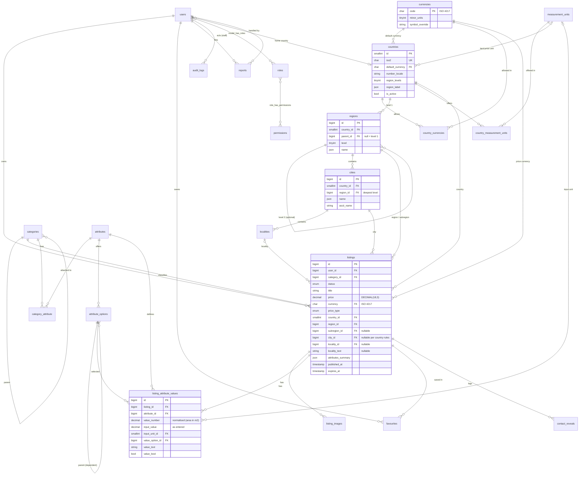

# Database Design

| Field | Value |
|---|---|
| Status | **Revised 2026-10-11 for the global marketplace (countries, currencies, locations, units). Awaiting owner review.** CD-04 (typed EAV + summary) remains approved. |
| Engine | MySQL 8.0+ / MariaDB 10.6+, InnoDB, `utf8mb4_unicode_ci` [RECOMMENDED minimum; production version OPEN] |
| Rules | All schema changes through Laravel migrations. No manual edits in production. Foreign keys enforced. |

## 1. ERD

Revised 2026-10-11 for the global marketplace ([global design](13-global-marketplace.md)).

## 2. Tables

Framework tables (`sessions`, `cache`, `cache_locks`, `jobs`, `job_batches`, `failed_jobs`, `password_reset_tokens`, `notifications`, `migrations`) and spatie/permission tables (`roles`, `permissions`, `model_has_roles`, `model_has_permissions`, `role_has_permissions`) are standard and not repeated here.

### 2.1 `users`

| Column | Type | Notes |
|---|---|---|
| id | bigint PK | |
| name | varchar(100) | Display name |
| email | varchar(191) unique | Lower-cased on save |
| email_verified_at | timestamp null | Required before posting |
| password | varchar(255) | bcrypt/argon2 |
| phone | varchar(20) null | International E.164 (e.g. `+94771234567`, `+447700900123`), validated with libphonenumber for `phone_country` |
| phone_country | char(2) null | ISO 3166-1 alpha-2 of the phone number |
| country_id | FK null → countries | Home/last-used country (defaults the posting wizard and browse country) |
| phone_verified_at | timestamp null | **Reserved for future OTP** (Q7). Unused in the MVP. |
| whatsapp_phone | varchar(20) null | Optional different WhatsApp number (E.164). Null means the same as `phone`. |
| contact_visibility | enum(`hidden`,`registered`,`public`) default `hidden` | Q6 |
| status | enum(`active`,`suspended`,`banned`) default `active` | |
| status_reason | varchar(500) null | Shown to the user |
| suspended_until | timestamp null | Null with `suspended` means indefinite |
| two_factor_secret, two_factor_recovery_codes, two_factor_confirmed_at | Fortify columns (encrypted with `APP_KEY`) | Staff 2FA ([2FA doc](12-authentication-and-2fa.md)) |
| locale | varchar(5) default `en` | Future |
| last_login_at | timestamp null | |
| remember_token | | |
| anonymised_at | timestamp null | Set by retention job |
| legal_hold | bool default false | Retention job skips held records ([retention](09-data-retention.md) §3) |
| timestamps, deleted_at | | Soft delete = account deletion requested |

Indexes: `email` (unique), `phone`, `(status)`, `deleted_at`.

### 2.2 Countries, Currencies, Locations and Units (Global)

**Replaced 2026-10-11.** The Sri Lanka-only `provinces`, `districts`, `cities` tables are replaced by the global model. Full column lists: [global design](13-global-marketplace.md) §2–§5.

| Table | Purpose |
|---|---|
| `countries` | ISO codes, default currency, number locale, phone code, timezone, region levels and labels, require flags, land units, active flag |
| `currencies` | ISO 4217 code, minor units, symbol override, display decimals |
| `country_currencies` | Allowed listing currencies per country (MVP: default only) |
| `regions` | Level 1 and optional level 2 administrative divisions (`parent_id`, `level`) |
| `cities` | Cities/towns linked to the deepest region level, with `country_id` denormalised |
| `localities` | Optional curated neighbourhoods |
| `location_requests` | "My town isn't listed" queue |
| `measurement_units`, `country_measurement_units` | Area units (factor to m²) and which units each country offers |

Superseded Sri Lanka-only design (kept for history)

| Table | Columns | Notes |
|---|---|---|
| `provinces` | id, name (json translatable), slug unique, sort_order | 9 rows |
| `districts` | id, province_id FK, name (json), slug unique, sort_order | 25 rows |
| `cities` | id, district_id FK, name (json), slug, is_active, sort_order; unique `(district_id, slug)` | Seeded with main towns. Admin-editable. |

### 2.3 `categories`

| Column | Type | Notes |
|---|---|---|
| id | bigint PK | |
| parent_id | FK null → categories | Max depth 2 (enforced in code) |
| name | json | Translatable |
| slug | varchar(120) unique | English, stable. Changing it creates a 301 (stored in `slug_redirects`, see below). |
| description | json null | |
| icon | varchar(60) null | Icon name from the UI icon set |
| sort_order | int | |
| is_active | bool | |
| scope_countries | json null | ISO2 list where this category is offered (e.g. Three-wheelers: `["LK","IN"]`). Null = all active countries. |
| allowed_types | json | e.g. `["sale","rent"]` |
| price_mode | enum(`required`,`optional`,`none`) | `none` for "Wanted"-only categories |
| allow_free | bool | |
| allowed_price_types | json | e.g. Land: `["fixed","negotiable"]`. Null = all types (subject to `allow_free`). |
| unit_price_attribute_id | FK null → attributes | Enables a calculated unit price. Land → `land_size` (ADR-018). Null for every other category. |
| unit_price_label | varchar(20) null | e.g. `perch` (translation key `units.perch`) |
| show_condition | bool | |
| max_images | tinyint default 8 | |
| moderation | enum(`inherit`,`always`,`never`) default `inherit` | Overrides the site setting |
| meta_title, meta_description | json null | |
| timestamps | | |

Indexes: `(parent_id, sort_order)`, `(is_active)`.

> **Implementation note (T3.1):** `unit_price_label` is **not** created. ADR-021 moved the "price per" unit to the listing country (`countries.land_price_unit_id`), and a per-category `perch` label would hardcode a land unit. `unit_price_attribute_id` is added in T3.2 together with the `attributes` table it references. `parent_id` uses `ON DELETE RESTRICT`; the two-level rule, self-parent, empty `allowed_types` and unknown enum values are rejected in `App\Models\Category` (`InvalidCategoryTree`). The "no children under a category that has listings" rule and the listings FK (`RESTRICT`) arrive with the listings table in T4.1.

### 2.4 `attributes`

| Column | Type | Notes |
|---|---|---|
| id | bigint PK | |
| key | varchar(60) unique | e.g. `make`, `mileage_km`. Stable, used in filter URLs. |
| label | json | Translatable |
| type | enum(`text`,`number`,`select`,`multiselect`,`boolean`,`year`) | |
| unit | varchar(20) null | `km`, `cc`, `perches`, `sqft`, `GB` |
| rules | json null | `{min, max, maxlength, step}` |
| depends_on_attribute_id | FK null → attributes | Dependent select (Model depends on Make) |
| help_text | json null | |
| is_active | bool | Deactivated, never hard-deleted, once used (CAT-06) |
| timestamps | | |

### 2.5 `attribute_options`

| Column | Type | Notes |
|---|---|---|
| id | bigint PK | |
| attribute_id | FK | |
| parent_option_id | FK null → attribute_options | e.g. Model "Aqua" → Make "Toyota" |
| value | varchar(80) | Slug used in URLs |
| label | json | |
| sort_order, is_active | | |
| scope_countries | json null | ISO2 list where this option is offered (e.g. Sri Lankan deed types: `["LK"]`). Null = all. |

Unique `(attribute_id, parent_option_id, value)`. Index `(attribute_id, is_active, sort_order)`.

### 2.6 `category_attribute` (pivot)

| Column | Type |
|---|---|
| category_id, attribute_id | composite PK |
| is_required | bool |
| is_filterable | bool |
| show_on_card | bool |
| group | varchar(40) null (form section, e.g. "Specs") |
| sort_order | int |
| scope_countries | json null (attribute shown only in these countries; null = all) |

Effective attributes for a subcategory = parent's attributes + its own. The child's pivot overrides the parent's when both attach the same attribute.

> **Implementation note (T3.2):** two columns were added beyond §2.4–§2.6: `attributes.allows_other` (a select offers "Other" + free text, input `attributes[<key>__other]`; `other` is a reserved option value) and `category_attribute.required_for_conditions` (JSON list of item conditions, e.g. mileage required only for `used`/`reconditioned`). `categories.unit_price_attribute_id` now exists (FK, `ON DELETE SET NULL`). Area attributes entered with a unit (`land_size`, `input_value`/`input_unit_id`) are **not** in T3.2: they come with the measurement units in **T1.5**, which extends `AttributeSchema`. `AttributeSchema` (`App\Services\Attributes`) merges parent + leaf links, drops inactive/out-of-scope attributes and options (a dependent option also needs its parent option), drops a dependent select whose parent select is missing, and returns a `CategorySchema` with `rules()` (unknown keys rejected, dependent selects checked against the chosen parent), `form()` and `validationAttributes()`. Cached per category + country in one catalogue cache generation, renewed by any category, attribute, option or link change. The "deactivate, never delete once used" check (CAT-06) needs listing values and arrives with T4.1/T4.2.

### 2.7 `listings`

| Column | Type | Notes |
|---|---|---|
| id | bigint PK | Appears in URL |
| user_id | FK → users | |
| category_id | FK → categories | Must be a leaf category |
| type | enum(`sale`,`rent`,`wanted`) | |
| status | enum(`draft`,`pending_review`,`active`,`rejected`,`suspended`,`sold`,`expired`) | |
| title | varchar(100) | |
| slug | varchar(120) | Regenerated on title edit. Redirect uses the id. |
| description | text | Plain text, max 5,000 chars |
| price | DECIMAL(18,3) null | Original asking price in `currency`. Decimals ≤ the currency's `minor_units`. Never converted or overwritten (ADR-020). |
| currency | char(3) FK → currencies | ISO 4217. Defaults from the listing country. Kept on the listing so later changes to a country's default currency don't affect it. |
| price_type | enum(`fixed`,`negotiable`,`free`,`on_request`) | |
| rent_period | enum(`day`,`month`,`year`) null | For rent listings |
| condition | enum(`new`,`used`,`reconditioned`) null | |
| country_id | FK → countries | Required |
| region_id | FK null → regions (level 1) | Required where `countries.require_region` |
| subregion_id | FK null → regions (level 2) | When the country has 2 region levels |
| city_id | FK null → cities | Required where `countries.require_city` |
| locality_id | FK null → localities | Optional |
| locality_text | varchar(80) null | Optional free-text area (shown, not filterable, moderated). Never a street address. |
| show_call, show_whatsapp | bool | Per-listing toggles, combined with `users.contact_visibility` |
| attributes_summary | json null | Denormalised `{key: display value}` for cards |
| cover_image_id | FK null → listing_images | |
| view_count | int unsigned default 0 | |
| moderation_note | varchar(500) null | Rejection or suspension reason shown to the seller |
| moderated_by | FK null → users | |
| moderated_at, submitted_at, published_at, expires_at, sold_at, renewed_at | timestamp null | |
| flagged | bool default false | Keyword or duplicate screener hit |
| legal_hold | bool default false | Retention job skips held records |
| timestamps, deleted_at | | |

### 2.8 `listing_attribute_values`

| Column | Type | Notes |
|---|---|---|
| id | bigint PK | |
| listing_id | FK, cascade delete | |
| attribute_id | FK | |
| value_number | decimal(15,2) null | number, year |
| value_option_id | FK null → attribute_options | select. Multiselect = one row per option. |
| value_text | varchar(255) null | text |
| value_bool | bool null | boolean |
| input_value | DECIMAL(18,4) null | Value as entered (e.g. `2` for 2 acres). Source of truth for unit-based attributes. |
| input_unit_id | FK null → measurement_units | Unit as entered. `value_number` then holds the normalised base value (area in m²) for filtering. |

Indexes: `(listing_id)`, `(attribute_id, value_option_id, listing_id)`, `(attribute_id, value_number, listing_id)`, `(attribute_id, value_bool, listing_id)`.

> **Implementation note (T4.1):** `listings`, `listing_attribute_values` and `listing_images` exist with the §4 / global §9 indexes (FULLTEXT `(title, description)` on MySQL/MariaDB only; SQLite tests skip it). Deviations: the three EAV indexes have explicit short names (`lav_attribute_*_listing_index`; generated names exceed the 64-character MySQL limit, now guarded by `IdentifierLengthTest`); `value_number` is `DECIMAL(18,4)` (not 15,2) so normalised m² keeps the 4 decimals `AreaConverter` produces; `listing_images` gets indexes `(listing_id, sort_order)`, `(listing_id, created_at)` (orphan cleanup) and `sha256`, and `basename` is unique. **Public scope** (`Listing::public()`): status `active`, `expires_at > now()` (query time), not soft-deleted, owner may act (`User::activeAccounts()`: active, or a suspension that has ended; deleted owners excluded), country active, **and category plus its parent active** (added: ads in a switched-off category should not stay visible). Integrity: a category with listings (even soft-deleted ones) cannot be deleted or get subcategories; attributes and options used by listing values cannot be deleted (CAT-06), with `RESTRICT` foreign keys as backstop. The slug follows the title; status, moderation and counters are not mass-assignable.

### 2.9 `listing_images`

| Column | Type | Notes |
|---|---|---|
| id | bigint PK | |
| listing_id | FK null | Null while uploaded in a draft before the listing row exists (cleaned up after 24 h) |
| user_id | FK | Uploader (ownership check) |
| disk | varchar(20) | `listings` |
| directory | varchar(191) | e.g. `2026/10/1234` |
| basename | char(32) | Random. Variants are `{basename}-lg.webp` and `{basename}-sm.webp`. |
| format | enum(`webp`,`jpg`) | |
| width, height | smallint | Of the large variant |
| bytes | int | Total of variants |
| sha256 | char(64) | Of the normalised large image. Used for duplicate and banned-image detection (future). |
| sort_order | tinyint | |
| timestamps | | |

### 2.10 Engagement and Trust

| Table | Columns | Notes |
|---|---|---|
| `favourites` | user_id, listing_id (composite PK), created_at | |
| `contact_reveals` | id, listing_id, user_id null, channel enum(`call`,`whatsapp`), ip_hash char(64), created_at | Rate-limit evidence and seller stats. Pruned after 90 days [proposed]. `ip_hash` = HMAC(ip, app key) with no raw IP stored. |
| `reports` | id, reporter_id FK, reportable_type, reportable_id (listing or user), reason enum, details varchar(1000), status enum(`open`,`actioned`,`dismissed`), handled_by FK null, handled_at, resolution_note, timestamps | Unique open report per `(reporter, reportable)` |
| `blocked_terms` | id, term varchar(100), match enum(`word`,`phrase`), action enum(`flag`,`block`), country_id null (null = global), created_by, timestamps | KeywordScreener. Per-country prohibited terms. |
| `audit_logs` | id, actor_id FK null, action varchar(60), subject_type, subject_id, reason varchar(500) null, changes json null, ip_hash, created_at | Append-only. No update or delete through the app. |

### 2.11 Content and Settings

| Table | Columns | Notes |
|---|---|---|
| `pages` | id, slug unique, title json, body json (sanitised Markdown source), is_published, meta json, timestamps | Terms, Privacy, Safety, Prohibited items, FAQ, About |
| `settings` | key varchar(80) PK, value json, updated_by, updated_at | Read through `Settings` with defaults from `config/marketplace.php` |
| `slug_redirects` | id, type (`category`), old_slug, target_id, created_at | 301s for renamed categories |

### 2.12 Reserved for Future (not created in the MVP)

`conversations`, `messages` (internal messaging), `saved_searches`, `featured_listings` / `orders` / `subscriptions` (paid features), `user_identities` (SSO), `exchange_rates` (base, quote, rate, source, fetched_at — future display-only conversion, never applied to stored prices).

## 3. Business Constraints in the Schema

- `listings.category_id` must reference an active leaf category. This is checked in the FormRequest, since a FK can't express it.
- Deleting a category with listings is blocked (`restrictOnDelete`).
- Deleting a user is a soft delete. A hard delete happens only through the retention job after anonymisation (see [data retention](09-data-retention.md)).
- `audit_logs.actor_id` is `nullOnDelete`, so logs survive account purges.

## 4. Index Strategy (Main Queries)

| Query | Index |
|---|---|
| Category browse, newest | `listings (status, category_id, published_at)` |
| Location browse | `listings (status, country_id, published_at)`, `(status, country_id, category_id, published_at)`, `(status, region_id, published_at)`, `(status, subregion_id, published_at)`, `(status, city_id, published_at)` — see [global design](13-global-marketplace.md) §9 |
| Price in one currency | `listings (status, country_id, currency, price)`, `(status, category_id, currency, price)` |
| Price sort/filter | `listings (status, category_id, price)` |
| Expiry job | `listings (status, expires_at)` |
| My listings | `listings (user_id, status, updated_at)` |
| Keyword search | `FULLTEXT listings (title, description)` |
| Attribute filters | `listing_attribute_values` composite indexes (§2.8), joined via `EXISTS` sub-queries per filter |
| Moderation queue | `listings (status, submitted_at)` |
| Reports queue | `reports (status, created_at)` |

**Validation plan (Phase 5/7):** seed 50k listings with realistic attributes, then `EXPLAIN` every search pattern. If attribute filters on the biggest categories (cars) exceed the latency target, add **generated hot columns** (e.g. `year`, `mileage`, `make_option_id`) on `listings` for the top 3–4 filters. This is an additive change.
> **Validated (T5.4, 2026-10-13):** see [performance check](../operations/performance.md). With 50,000 listings and 20,000 users every planned query uses its index; no index was added. The public scope was rewritten (category exclusion list, owner check as NOT EXISTS) and the result count capped at 2,401, because MariaDB otherwise lost the newest-first index order. Very common keywords are the slowest case (p95 ≈ 300 ms). Re-run on the target host before launch.

## 5. Portability Rules for the Schema

- **No absolute URLs of our own site are stored.** Images store `disk` + relative `directory` + `basename`. URLs are built at runtime from the disk config (`LISTINGS_URL`). Pages store Markdown with relative links.
- **Listing slug changes need no redirect table:** the URL is resolved by `id`, and a mismatched slug gets a 301 to the canonical `/ad/{slug}-{id}` (CD-12). Listing ids are preserved across any hosting or domain migration (the same DB is moved).
- Only portable SQL features: InnoDB, utf8mb4, JSON via casts, varchar enums. No triggers, procedures, events or views. FULLTEXT is used only inside `MysqlListingSearch`.
- Reference data (roles, permissions, countries, currencies, measurement units, categories, attributes) is seeded by **idempotent** seeders (`updateOrCreate` on stable keys), safe to re-run on any environment.
- See [domain migration and portability](11-domain-migration-and-portability.md) §1 and §7.

## 6. Data Types and Conventions

- Money: `DECIMAL(18,3)` amount + `CHAR(3)` ISO 4217 currency on the listing. bcmath for arithmetic, ICU (PHP intl) for formatting via one `Money` service (ADR-020).
- Areas: entered value + unit, plus normalised m² for filtering (ADR-021).
- Timestamps: stored in UTC, displayed in `Asia/Colombo`.
- Enums: PHP backed enums. DB columns are `varchar(20)` (not native ENUM) so values can be added without an `ALTER`. Valid values are enforced by casts and validation.
- Slugs: ASCII. A Sinhala or Tamil title produces a transliteration-free fallback slug (`listing`), and the id keeps the URL unique.
