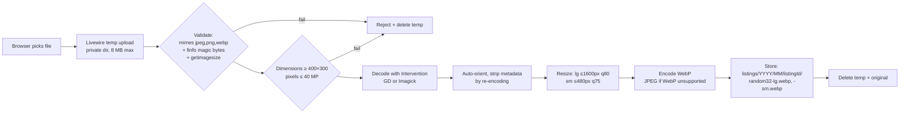

# Security Design and Image Uploads

| Field | Value |
|---|---|
| Status | **Revised 2026-10-11 (CD-10, CD-11 approved). Awaiting approval of the revised design.** |
| Scope | Design-level controls. Phase 8 verifies them against the built system. |

## 1. Threat Summary

| Threat | Main controls |
|---|---|
| Spam / scam listings, fake accounts | Email verification, Turnstile, rate limits, pre-moderation, keyword screener, duplicate detector, reports, bans |
| Phone number scraping | No numbers in HTML, reveal endpoint with rate limit + logging, seller visibility levels, Turnstile challenge after a threshold |
| Account takeover | Hashed passwords, login throttling, session regeneration, 2FA for Owner/Admin, password confirmation for sensitive actions |
| Privilege escalation / IDOR | Policies and permissions on every action, 404 for hidden resources, hierarchy guard, Livewire locked properties |
| XSS | Blade escaping. Descriptions are plain text (`e()` + `nl2br`). Static pages use sanitised Markdown. CSP. |
| CSRF | Laravel CSRF on all state-changing routes (Livewire included) |
| SQL injection | Eloquent / query builder bindings. FULLTEXT terms sanitised for boolean-mode operators. Attribute filter keys are whitelisted against the schema. |
| Malicious uploads | §4 pipeline |
| Mass assignment | `$fillable` on every model. Actions use validated data only. |
| Secrets leakage | `.env` outside the web root, never committed. `APP_DEBUG=false`. Custom error pages. |
| DoS / abuse of heavy endpoints | Rate limiting, pagination caps, image pixel limits, filter count limits |

## 2. Authentication and Sessions

- Fortify: registration, login, email verification, password reset, password confirmation, TOTP 2FA (mandatory for Owner/Admin, CD-11). Method, enforcement and recovery process: [authentication and 2FA](12-authentication-and-2fa.md). Passkeys are disabled (domain-bound, ADR-015).
- **Host safety:** `TrustHosts` restricted to the `APP_URL` host. `URL::forceRootUrl(APP_URL)` so password-reset and verification links can never be generated for an attacker-supplied Host header.
- Passwords: min 10 chars, `Password::defaults()` with `uncompromised()` (HIBP k-anonymity check over outbound HTTPS, skipped if unreachable) [RECOMMENDED].
- Login throttle: 5/min per email+IP, 30/min per IP. Generic error messages (no account enumeration). Reset requests return the same response for unknown emails.
- Sessions: `database` driver, cookie `dtm_session`, `Secure`, `HttpOnly`, `SameSite=Lax`, **host-only** (`SESSION_DOMAIN=null`). Regenerated on login and privilege change. 120 min lifetime. Staff sessions use a 30-minute idle timeout.
- Suspend or ban invalidates sessions (DB sessions are deleted by `user_id`).

## 3. Rate Limits (Initial Values, Configurable)

| Limiter | Limit |
|---|---|
| login | 5/min per email+IP |
| register | 5/hour per IP |
| password-reset | 3/min, 10/hour per IP |
| listing-submit | 10/day per user (LST-09), 30/hour per IP |
| image-upload | 60/hour per user |
| contact-reveal | 30/hour per user, 10/hour per guest IP. Turnstile after 5 guest reveals/hour. |
| report | 10/day per user |
| search | 120/min per IP |

## 4. Image Upload Pipeline

**Rules**

- The original upload is **never stored or served**. Only re-encoded variants exist, which removes EXIF/GPS and kills polyglot payloads.
- Filenames are random (32 hex chars). User-supplied names are never used.
- Allowed inputs: JPEG, PNG and WebP. HEIC is rejected in the MVP (GD can't decode it; iPhones convert to JPEG when uploading through browsers in most cases). SVG and GIF are rejected.
- Pixel-count limit applied **before** decoding (decompression bombs). `memory_limit` must be at least 256 MB (hosting doc).
- Max images per listing: category `max_images` = **8**, or **10** for Vehicles and Property [APPROVED CD-10]. Enforced server-side when the upload is attached, not only in the UI.
- Max upload size **8 MB per image** [APPROVED CD-10]. Enforced by validation (`max:8192`). Host `upload_max_filesize` ≥ 10M and `post_max_size` ≥ 12M are required [UNVERIFIED].
- **Two output sizes** [APPROVED]: `lg` (≤ 1600 px longest edge, listing detail/gallery and OG image) and `sm` (≤ 480 px, listing cards and search results; `srcset` 1×/2× uses `sm`/`lg`).
- Storage disk `listings`:
  - **Preferred:** root `storage/app/public/listings` served via the `public/storage` symlink.
  - **Fallback when symlinks are unavailable** [INFERRED risk on this host]: disk root inside `public/uploads/listings`. Same pipeline. The directory gets an `.htaccess` that disables script execution (`php_flag engine off` is unsupported on LiteSpeed/lsphp, so use `<FilesMatch "\.(php|phtml|phar|pl|py|cgi|sh)$"> Require all denied`) **and** a `RemoveHandler`. Verified by an automated test plus a manual check after deploy.
  - **Future:** S3-compatible object storage (config-only change).
- Orphan cleanup: images not attached to a listing within 24 h, and Livewire temp files older than 24 h, are deleted by the scheduler.
- Image processing is synchronous at upload (about 0.5–2 s per image) so posting never depends on the queue.
- **Processing-failure handling:** every step runs in a try/catch around Intervention decode/encode and storage writes. On any failure (corrupt file, unsupported codec, out-of-memory guard, disk full, write error): delete any variant already written, delete the temp file, keep no DB row, log a warning (file size, detected MIME, error class; no file contents), and show the seller a clear error ("This image could not be processed. Try a JPG or PNG under 8 MB."). The listing draft stays intact.
- **Validation summary:** extension allow-list + `mimes` + `finfo` magic-byte MIME + `getimagesize()` type match + min dimensions 400×300 + max 40 MP + max 8 MB + successful decode. All must pass.
- **URLs:** generated only via `Storage::disk("listings")->url()`. The disk root and public URL come from env (`LISTINGS_DISK_DRIVER`, `LISTINGS_ROOT`, `LISTINGS_URL`), so storage can move to object storage or a media domain without code changes ([portability](11-domain-migration-and-portability.md) P6).
- **Storage requirements:** see [hosting](08-hosting-and-deployment.md) §3 (disk and inode estimates). Hosting limits are [UNVERIFIED].

## 5. Content Safety

- Listing title and description are plain text: HTML is stripped on input and escaped on output. URLs are not auto-linked in the MVP (reduces off-platform scam links).
- `KeywordScreener` checks the title and description against `blocked_terms`: `block` gives a validation error, `flag` sends the listing to review even when moderation is off.
- Phone numbers and emails typed into descriptions are allowed but flagged in the moderation view (sellers should use the contact settings).
- Static pages: Markdown rendered with a safe converter (`league/commonmark` with `html_input: strip`, unsafe links disabled). Bundled with Laravel.

## 6. Bot Protection (Q8)

| Option | Pros | Cons | Verdict |
|---|---|---|---|
| **Cloudflare Turnstile** | Free, mostly invisible, privacy-friendly, **works without moving DNS to Cloudflare** (just a site key + server verification) | Needs outbound HTTPS from the host to `challenges.cloudflare.com` | **[RECOMMENDED]** |
| Google reCAPTCHA v3 | Familiar, invisible scoring | Google tracking, needs a cookie/privacy notice, score tuning | Fallback |
| hCaptcha | Privacy-focused | More visible challenges, friction | Fallback |
| Honeypot + time trap (no third party) | Zero cost, no external calls | Stops only simple bots | Always on, as a **second layer** |

Used on: register, login (after 3 failures), password reset, listing submit, report, and guest contact reveal after a threshold. If the Turnstile verify call fails because of a network error, the action is **allowed but flagged** for moderation (fail-open for listing submit, fail-closed for registration), and the error is logged. [OPEN: verify outbound HTTPS from the host.]

## 7. HTTP Security Headers

`SecurityHeaders` middleware: `Strict-Transport-Security` (production; `includeSubDomains` **not** set, because this app must not affect other Dev Talk subdomains), `X-Content-Type-Options: nosniff`, `X-Frame-Options: DENY`, `Referrer-Policy: strict-origin-when-cross-origin`, `Permissions-Policy` (camera, mic and geolocation off), and a **Content-Security-Policy** from day one with nonces for inline scripts (Livewire supports CSP nonces). Allowed sources: self, `challenges.cloudflare.com`. Analytics sources are added only if approved.

## 8. Privacy Controls

- Email is never shown publicly. Phone follows `contact_visibility`.
- IP addresses: stored only as HMAC hashes in `contact_reveals` and `audit_logs`. Raw IPs exist only in rotating server logs.
- Account deletion and anonymisation: see [data retention](09-data-retention.md).
- No third-party trackers in the MVP unless approved (affects the cookie notice).

## 9. Secrets and Configuration

- `.env` is outside the document root (the app root is above `public/`). `.env.example` is committed with no values.
- Keys: `APP_KEY`, DB credentials, mail credentials, `TURNSTILE_SITE_KEY` / `TURNSTILE_SECRET_KEY`. None are committed.
- Production: `APP_ENV=production`, `APP_DEBUG=false`, `LOG_LEVEL=warning`.
- Before each release: `composer audit` and `npm audit` (no high/critical findings).
